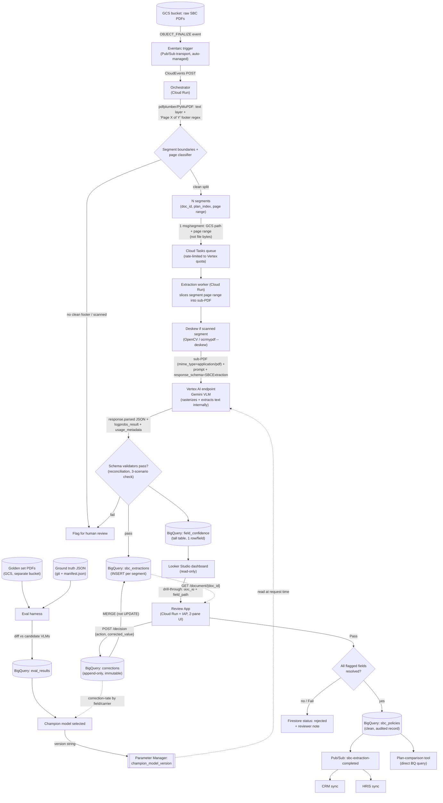

**What it does:** Ingests carrier-submitted Summary of Benefits and Coverage (SBC) PDFs, extracts them into a CMS-mandated structured schema using a vision-language model (VLM), routes low-confidence fields to human review, and writes an policy record consumable by downstream systems (CRM, HRIS, plan-comparison tools).

Schema-based extraction = pulling specific, structured fields out of unstructured/semi-structured input by mapping to a predefined schema.

## 1. Design rationale
### Why VLM, not a text-only LLM
- **Reading order ≠ visual order** — multi-column comparison tables don't linearize into text correctly.
### Why not pre-built parsers (LlamaParse, Document AI)
Document AI's Custom Extractor is itself now Gemini-powered — it's a managed platform _around_ the same VLM approach, not a different technology. Its Custom Splitter could genuinely replace hand-rolled segmentation, but the schema builder doesn't expose the same per-field prompt control the reconciliation logic needs. Net: same underlying VLM approach either way — calling the model directly just skips the fee and abstraction layer for a document type narrow and high-stakes enough that the real logic gets hand-written regardless.

---
## 2. Extraction schema
Defined as a **Pydantic model**, passed directly as `response_schema` in a Gemini structured-output call. Field `descriptions` **are** the per-field prompt instructions the model reads — not duplicated in the prompt text, which would be redundant, quality-reducing input.

**Top-level composition (`SBCExtraction`):**

| Section                       | Covers                                                                                                                                                                                             |
| ----------------------------- | -------------------------------------------------------------------------------------------------------------------------------------------------------------------------------------------------- |
| `plan_identification`         | Issuer, plan name, coverage period, coverage-for tier, plan type (HMO/PPO/EPO/POS/HDHP)                                                                                                            |
| `important_questions`         | Deductible (individual/family), services before deductible, other deductibles, OOP limits, referral requirement                                                                                    |
| `common_medical_events`       | ~29 named CMS rows (PCP visit, specialist, ER, drug tiers, imaging, mental health, pregnancy, pediatric dental/vision, etc.), each a `network_cost` / `out_of_network_cost` / `limitations` triple |
| `excluded_and_other_services` | "Generally does NOT cover" / "Other covered services" bullet lists                                                                                                                                 |
| `regulatory_attestations`     | Minimum Essential Coverage, Minimum Value Standards, language access                                                                                                                               |
| `coverage_examples`           | The 3 standardized CMS scenarios (having a baby, type-2 diabetes, simple fracture), each with cost-sharing components                                                                              |

Validation is enforced **in-schema**, not after the fact — e.g. the coverage-example cost-sharing model has a `model_validator` checking `deductibles + copayments + coinsurance + limits_or_exclusions == total_patient_pays` (within $1 rounding tolerance). A mismatch raises, which routes the record to human review rather than silently writing a misread value.

**The call:**

```python
response = client.models.generate_content(
    model=champion_model_version,          # read from Parameter Manager
    contents=[
        types.Part.from_text(EXTRACTION_PROMPT),
        *[types.Part.from_bytes(data=img, mime_type="image/png") for img in segment_page_images],
    ],
    config=types.GenerateContentConfig(
        response_mime_type="application/json",
        response_schema=SBCExtraction,
        response_logprobs=True,
        logprobs=3,
        media_resolution="MEDIA_RESOLUTION_HIGH",
    ),
)
record = response.parsed   # SBCExtraction instance; raises on schema/reconciliation failure
```

---

## 3. Architecture diagram



---

## 4. Pipeline walkthrough

### 4.1 Ingestion
- PDF lands in a GCS bucket → **Eventarc** trigger filtered on `google.cloud.storage.object.v1.finalized`, transported over an auto-managed Pub/Sub topic (not self-provisioned).
- Delivery: HTTP POST in CloudEvents format straight to the orchestrator (**Cloud Run**) — no polling.
- Constraint: bucket and trigger must share a region; a bucket allows at most 10 notification configs (irrelevant here, single-purpose bucket).

### 4.2 Segmentation
Handles a real production case: multiple SBCs (e.g. different plan tiers from an open-enrollment packet) appended into one PDF.

- Orchestrator pulls the PDF from GCS, extracts each page's text layer (**pdfplumber**/**PyMuPDF** — cheap, no model call), regexes the footer for `Page X of Y`.
- **Boundary rule:** counter resets (`Page 4 of 4` → `Page 1 of 3`) = hard document boundary — more reliable than page count alone (SBCs run 3–4 pages depending on plan year). Backup signal: the recurring page-1 header block, for carriers that omit the counter.
- One page-level pass does classification _and_ boundary detection together: for each page, "is this an SBC page" and "does the counter reset here" are answered from the same footer/header scan. Contiguous `is_sbc_page = true` runs become segments.
- **No clean footer (scanned/faxed, no text layer) → flagged for human review**, not silently extracted.
- Non-SBC pages (cover sheet, table of contents, an EOC stapled on the end) are dropped, not forced into a segment.
- A segment that doesn't cleanly resolve to one SBC (torn/duplicated pages) fails validation → human review, rather than silently extracting a merged, wrong record.
- Each segment gets a provisional plan identifier (issuer + plan name from its own page 1) and a `parent_doc_id` back-reference — needed later to know when _all_ segments of a bundled upload have reached `sbc_policies`.
- This is why the golden eval set needs a segmentation-accuracy metric, separate from field-extraction accuracy — bundled multi-plan PDFs are common in practice.

### 4.3 Dispatch — Cloud Tasks
- Orchestrator enqueues **one Cloud Task per segment**, carrying the GCS path + page range (not the file itself).
- Cloud Tasks over more Pub/Sub messages here specifically for **per-queue rate limiting** (max dispatches/sec) — needed to stay under Vertex AI's Gemini quota. Pub/Sub push subscriptions don't give that same dispatch-rate control.
- Division of labor: Pub/Sub (via Eventarc) answers "something happened, go react" — the trigger. Cloud Tasks answers "here's exactly what work to do and how fast" — the dispatcher.

### 4.4 Extraction — Cloud Run workers
Runs inside the extraction service, not the orchestrator (orchestrator only produces page ranges; never touches page content):

1. Pull the source PDF from GCS, extract **only** the segment's page range into a small sub-PDF (`pypdf`/`pikepdf` page copy — no rendering, just slicing pages).
2. **Rasterization and native text extraction are managed internally by Gemini** — send the sub-PDF directly with `mime_type="application/pdf"`; it converts pages to images and pulls the embedded text layer with no code on our side. Resolution is set via `media_resolution` (`low`/`medium`/`high`, or Gemini 3's per-part control) — tuned against the golden set, not a literal DPI knob.
3. Scans/faxes with no text layer are the one case still needing our own preprocessing: deskew the pages before handing off the sub-PDF (§4.4.1) — Gemini reads what it's given, it doesn't correct a tilted scan first.
4. One multimodal call per segment (per SBC), not per page — schema + prompt + the sub-PDF — so the model can reason across a value that spans a page break.
5. Scales to zero between bursts — no idle cost outside open-enrollment traffic spikes.

#### 4.4.2 Batch prediction as a cost optimization

Vertex AI's **Batch Prediction** API cuts the per-token rate ~50% versus the online call in §4.4, in exchange for asynchronous turnaround (24-hour completion SLA, not seconds). Since human review already happens after extraction, most traffic can absorb that delay for free.

- **Input:** a staging BigQuery table with a `request` column holding the same `GenerateContentRequest` JSON already built for the online call (`contents` = prompt + sub-PDF, `generationConfig` = `response_schema`, `response_mime_type`, `response_logprobs`, `media_resolution`) — the request itself doesn't change, only how it's submitted. Extra columns (`doc_id`, `segment_id`, `plan_index`, `model_version`) ride along untouched and land pre-joined in the output table — no separate lookup needed.
- **Job:** submitted against the staging table (`bq://project.dataset.table`), output to a second BigQuery table — both must sit in the same region as the job (multi-region datasets aren't supported).
- **Output:** reserved `response`/`status` columns per row, same shape as `response.parsed`/`logprobs_result` from the online path — schema validation and confidence-extraction code is reused unchanged; only the trigger differs.
- **Completion:** no push notification assumed by default — a **Cloud Scheduler** job polls job `state` on a fixed interval (e.g. every 15–30 min, generous against the 24h SLA) and, once `SUCCEEDED`, hands the output table to the same write path that already populates `sbc_extractions`/`field_confidence`.
- **A dispatch split, not a wholesale replacement:** bulk/steady-state segments (open-enrollment backfills, nightly volume) default to batch; the existing per-segment online path via Cloud Tasks stays live for anything time-sensitive — a manually re-triggered corrected resubmission, or golden-set eval iteration during active development, where a day's wait isn't acceptable.

### 4.5 Confidence scoring

- `response.candidates[0].logprobs_result` — token-level log-probabilities, chosen token + top-3 alternatives per position. Logprob closer to 0 = more confident; convert to probability with `math.exp(logprob)`.
- JSON is generated key-by-key in schema order, so the token stream is walked in that same order, slicing out tokens belonging to each field's value span; take the min (or average) probability across that span as the field's confidence.
- Written to a **tall** BigQuery table (§6) — adding a schema field later just means new rows appear, no `ALTER TABLE`.

### 4.6 Model selection & golden-set evaluation

Golden dataset stratified across:

|Axis|Values covered|
|---|---|
|Carrier/vendor rendering|Multiple carriers, not just multiple documents — same content renders differently per vendor|
|Document quality|Born-digital vs. scanned/faxed|
|Bundling|Single-plan vs. multi-plan bundled PDF (tests segmentation)|
|Plan type|HMO/PPO/EPO/POS/HDHP|
|Template/plan-year version|CMS revises the template periodically|
|Field edge cases|"Not covered" vs. blank vs. "N/A", footnote-heavy cells, multi-line answers|
|Adversarial|Non-SBC docs (reject path), torn/duplicate pages (validation-failure path)|

- **Storage split:** PDFs → GCS (separate bucket from production ingestion, so eval runs never trigger the real pipeline). Ground truth → git, one JSON per PDF shaped like `SBCExtraction`. `manifest.json` in the repo joins GCS path ↔ ground-truth path ↔ metadata (tier, carrier, is_scanned, plan_year).
- **Harness:** reads `manifest.json` → pulls PDF from GCS + expected JSON from git → runs extraction through each candidate VLM → diffs field-by-field.
- **Metrics are field-level, not document-level** — exact match for categorical fields, numeric tolerance for dollar amounts ("close" on a deductible is still wrong).
- **Results → BigQuery**, per-document/per-field pass-fail, tagged `model_version` + `schema_version` + `run_timestamp`.
- **Champion** = best score on the golden set (weighted toward table-heavy pages and reconciliation checks), pinned as the production model.
- **Regression gate:** every prompt/schema/model change re-runs against the golden set before rollout; block on regression. Schema/prompt changes go through the _same_ gate as model changes — a schema tweak breaks extraction as easily as a bad prompt.

Champion model name lives in **Parameter Manager**, not hardcoded or in Secret Manager — see §8.

### 4.7 Monitoring

- **Model-level:** confidence-score distribution per field; drift signals a new carrier template broke something.
- **Ops-level:** latency, cost per page, queue depth.
- **Business-level:** human-correction rate per field, per carrier — the earliest warning that a vendor changed their SBC layout.
- **Alert on correction-rate spikes, not just error logs** — a template change fails silently (valid-looking JSON, wrong values); it won't throw exceptions.
- Surfaced via a read-only **Looker Studio** dashboard over `field_confidence` and `corrections` (queue depth, avg confidence by carrier/field, correction-rate trend, reviewer throughput). Each row carries a drill-through URL (`https://review-app.internal/doc/{doc_id}?field={field_path}`) into the actual fix tool — Looker Studio is triage, not the fix, since it's read-only.

### 4.8 Human review — what the analyst sees

A small **Cloud Run** app, not a dashboard (Looker Studio can't write).

- **Auth:** Identity-Aware Proxy in front of Cloud Run — reviewer identity for free, no separate login system, every write attributable to a real identity for the audit trail.
- **Layout:** two vertical panes — PDF viewer on the right (jumps to the relevant page for the focused field), schema-driven field form on the left, grouped by schema section.
- High-confidence fields show a badge and stay collapsed/read-only-by-default (still expandable) — the point of scoring confidence is not wasting reviewer attention re-confirming fields the model already got right. Low-confidence fields are expanded with an inline edit control.
- **Per-field actions:** Accept (false-positive low-confidence flag — itself a useful calibration signal), Correct (overwrite), Escalate (genuinely ambiguous — illegible scan, contradictory text — routes to a second reviewer instead of forcing a guess).
- **Endpoints:**
    - `GET /review-queue` — reads `field_confidence` filtered `confidence < threshold`; what the Looker drill-through lands on.
    - `GET /document/{doc_id}` — pulls the current record from `sbc_extractions` + a **signed, time-limited** GCS URL for the source page image (no public bucket access for a compliance-adjacent document).
    - `POST /document/{doc_id}/decision` — body `{action, corrected_value?, reviewer_note?}`. Writes the `corrections` log entry **first**, then the `sbc_extractions` update — so a partial failure leaves the audit trail intact even if the live update fails.
- **Pass/Fail semantics, not just a button:**
    - Pass is disabled until every flagged field has an explicit disposition (accepted-as-is or corrected) — otherwise a reviewer can miss one and still ship it.
    - On Pass: write every touched field to `sbc_extractions`, append every touched field to `corrections` (including "confirmed correct" as its own outcome — distinguishes "reviewer looked and agreed" from "nobody looked"), flip **Firestore** status to `complete`, fire the completion Pub/Sub event.
    - Fail → distinct `rejected` status + reviewer note, so an unresolvable document (illegible scan, contradictory source) shows up in monitoring as its own category instead of silently vanishing.
- No separate database for the app's own state — reads/writes the same BigQuery tables and Firestore status store the rest of the pipeline uses. One source of truth, not a shadow copy that can drift.

### 4.9 Promotion to `sbc_policies`

- `sbc_extractions` corrections apply via **`MERGE`**, not per-click `UPDATE` — BigQuery isn't built for frequent small row-level mutations (`UPDATE` has to scan/locate/rewrite; hits rate limits at volume). The app appends to `corrections` (already append-only), and either a periodic MERGE sweep or a per-`doc_id`-scoped MERGE on Pass applies the latest correction per field as one set-based statement.
- On Pass with all fields resolved, the final audited record is written to **`sbc_policies`** — a clean table, separate from the working `sbc_extractions` table. Nothing downstream (broker CRM sync, plan-comparison indexer, HRIS integration) should ever query `sbc_extractions` directly, since it can legitimately hold unreviewed/low-confidence/in-progress data. `sbc_policies` is the only place "if it's here, a human has audited it" is a guaranteed property.
- **Reprocessing the same carrier+plan+plan_year** (corrected extraction, resubmitted SBC) never blind-overwrites — insert a new row, set `superseded_by` on the old one and `effective_date` on the new one. A "current policy" query just filters `superseded_by IS NULL`; full history stays queryable for audit.
- **Parent-document rollup:** a bundled upload isn't "done" until every child segment has reached `sbc_policies` — tracked via `parent_doc_id` + a completeness check across children, otherwise a partially-processed bundle (2 of 3 plans done) has no signal anywhere that one is still missing.

### 4.10 Downstream consumption

- **Push:** more subscribers on the `sbc-extraction-completed` Pub/Sub topic — a CRM-sync and an HRIS-sync service each read the event, pull the record by `policy_id` from `sbc_policies`.
- **Pull:** an internal plan-comparison tool queries `sbc_policies` directly — the first place in the pipeline BigQuery gets used for what it's actually built for ("compare deductibles across all Gold plans for this renewal year" is a real analytical query, not a lookup).

### 4.11 Feedback loop / MLOps

- Corrections that reveal a genuinely new failure pattern (not a typo) get promoted into the golden set.
- Correction-rate per field/carrier (from the `corrections` log) is what actually fires the "something's degrading" alert — not calendar-based retraining.
- Version prompt, schema, model, and golden set **together** — a rollback is one atomic revert, not four uncoordinated ones.
- Shadow or canary a new version against live traffic before full cutover, compared against the golden-set eval, not vibes.
- Model version is never hardcoded per call site — swapping champions is a Parameter Manager version publish (instant rollback), not a code change. Old BigQuery records keep their original `model_version` tag permanently, so "which model produced this record" stays answerable for audit even after the model itself is deprecated.

---

## 5. How data is passed, hop by hop

|Hop|What's passed|Format / transport|
|---|---|---|
|GCS upload → Eventarc|Bucket + object name (event metadata, not bytes)|CloudEvents HTTP POST|
|Orchestrator → Cloud Tasks|GCS path, page range, provisional plan id, `parent_doc_id` — one task per segment|JSON task payload|
|Cloud Tasks → extraction worker|Same payload|HTTP push|
|Extraction worker → Vertex AI|Segment sub-PDF (`mime_type=application/pdf`, pages sliced not rendered) + prompt + `response_schema` — Gemini rasterizes + extracts text internally|One multimodal `generateContent` call per segment|
|Vertex AI → extraction worker|`response.parsed` (typed object), `logprobs_result`, `usage_metadata`|JSON + token-level logprobs|
|Extraction worker → BigQuery|Full extraction record; one row per field with its confidence|`INSERT` into `sbc_extractions`, `field_confidence`|
|Looker Studio → Review App|`doc_id`, `field_path`|URL query params (drill-through link)|
|Review App → BigQuery|`{action, corrected_value?, reviewer_note?}` per field|`POST` body → `corrections` insert, then `MERGE` into `sbc_extractions`|
|Review App → Firestore|Status transition (`needs_review` → `complete`/`rejected`)|Document update|
|Review App (Pass) → BigQuery|Final audited record|`INSERT` into `sbc_policies` (+ `superseded_by` on prior row if reprocessed)|
|`sbc_policies` → downstream|`policy_id` (push) / full record (pull)|Pub/Sub message / direct SQL query|

---

## 6. What's in BigQuery

|Table|Purpose|Write pattern|Key|
|---|---|---|---|
|`sbc_extractions`|Working record per segment — may hold unreviewed/low-confidence data|`INSERT` by extraction worker; `MERGE` by review app|`(source_doc_id, plan_index, plan_name)`|
|`field_confidence`|Tall table: `doc_id \| segment_id \| field_path \| extracted_value \| confidence \| model_version \| run_timestamp`|`INSERT` per field per run|New fields just appear as new rows — no `ALTER TABLE`|
|`corrections`|Immutable audit log: `doc_id, field_path, model_value, corrected_value, action, reviewer_id, timestamp`|Append-only `INSERT`, written before the `sbc_extractions` merge|Feeds golden-set promotion + correction-rate monitoring|
|`sbc_policies`|Clean, human-audited final policy record — the only table downstream systems should query|`INSERT` on reviewer Pass; supersede, never overwrite|`policy_id`; `superseded_by` / `effective_date` for history|
|`eval_results`|Golden-set eval outcomes, per-document/per-field pass-fail|`INSERT` per eval run|Tagged `model_version`, `schema_version`, `run_timestamp`|

Per-document/segment _status_ (`pending`/`needs_review`/`complete`/`rejected`) lives in **Firestore**, not BigQuery — see §8 for why.

---

## 7. GCP services map

|Component|Service|Role|
|---|---|---|
|Raw document landing|**GCS**|Ingestion bucket; also hosts the separate golden-set bucket|
|Trigger|**Eventarc**|`OBJECT_FINALIZE` → orchestrator, Pub/Sub-backed transport|
|Orchestration & extraction|**Cloud Run**|Stateless services, scale to zero between bursts|
|Rate-limited dispatch|**Cloud Tasks**|Per-queue dispatch rate matched to Vertex AI quota|
|Model hosting & eval|**Vertex AI**|Gemini endpoint for extraction calls; hosts eval-harness jobs|
|Config for champion model|**Parameter Manager**|Runtime-mutable, versioned, no redeploy for cutover/rollback|
|Structured output + monitoring|**BigQuery**|`sbc_extractions`, `field_confidence`, `corrections`, `sbc_policies`, `eval_results`|
|Fast per-document status|**Firestore**|`pending`/`needs_review`/`complete`/`rejected`, `parent_doc_id` rollups|
|Dashboard|**Looker Studio**|Read-only ops/business monitoring, drill-through into the review app|
|Human review UI|**Cloud Run + Identity-Aware Proxy**|Two-pane correction app, identity-attributed writes|
|Fan-out on completion|**Pub/Sub**|`sbc-extraction-completed` topic → CRM sync, HRIS sync subscribers|

---

## 8. Key tradeoffs

|Decision|Chosen|Alternative|Why|
|---|---|---|---|
|Extraction approach|Direct Vertex AI VLM call|LlamaParse / Document AI|Same underlying model either way; direct call keeps per-field prompt control where SBC accuracy actually lives (N/A vs. blank vs. "not covered", cross-field reconciliation) — pre-built tools cap precision and add cost/compliance surface without buying that control back|
|PDF → image conversion|Native Gemini PDF vision (sub-PDF, `mime_type=application/pdf`)|Manual rasterization (PyMuPDF/pdf2image at fixed DPI)|Native handling means page rasterization + text extraction need no code and stay current with model updates; manual rasterization trades that away for exact pixel/DPI control that `media_resolution`'s three tiers don't expose — only worth it if a specific carrier's tables need finer control than `high` gives|
|Schema definition|Hardcoded CMS schema|User-defined per-document schema (generic tool pattern)|CMS legally mandates the exact fields — hardcoding is a real head start, not a limitation, for this narrow document type|
|Ingestion dispatch|Cloud Tasks|More Pub/Sub messages|Cloud Tasks gives per-queue rate limiting to match Vertex AI quota; Pub/Sub push doesn't give that dispatch-rate control|
|Extraction request mode|Hybrid — batch default, online fallback|Online-only (per-segment synchronous calls)|Batch Prediction cuts Vertex AI token cost ~50% for the bulk/steady-state share of traffic; human review is already async, so a 24h SLA costs nothing end-to-end. Online path stays live for time-sensitive one-offs — re-triggered corrections, golden-set iteration — where a day's wait isn't acceptable|
|Corrections/audit destination|**BigQuery**|Cloud Logging|Corrections, confidence scores, and eval results all need field/carrier-level structured queries (correction-rate trends, golden-set joins) — Cloud Logging is fine for ops search, weak for that kind of compliance/analytical query|
|Correcting `sbc_extractions`|`MERGE`|Per-click `UPDATE`|BigQuery isn't built for frequent small row-level mutations — `UPDATE` scans/rewrites and hits rate limits at review volume; `MERGE` applies all pending corrections as one set-based op|
|Per-document status tracking|**Firestore**|BigQuery|Status flips are frequent, single-row, low-latency reads/writes — the same profile that makes `UPDATE` a poor fit for BigQuery above; Firestore is built for exactly this|
|Working vs. final record|Two tables (`sbc_extractions` / `sbc_policies`)|One table with a `status` column|Guarantees downstream consumers can never accidentally read unreviewed data — `sbc_policies` existing at all _means_ audited|
|Reprocessed records|Insert + `superseded_by`|Overwrite in place|Keeps full history queryable for audit while "current" stays a simple filter (`superseded_by IS NULL`)|
|Model version config|**Parameter Manager**|Hardcoded string / Secret Manager|Runtime-mutable without redeploy (unlike hardcoding) and versioned for instant rollback (unlike Secret Manager, which isn't built for general non-sensitive config)|

## Challenges:
1. **Vertex AI quota/rate limits during open-enrollment surges** — Traffic spikes seasonally (Q4 enrollment). _Solution:_ Cloud Tasks queue already rate-limits dispatch to quota; add Batch Prediction (§4.4.2) as the default path to absorb bulk volume async, reserving online quota for time-sensitive re-submissions.
2. **Reviewer trust/adoption** — Analysts may not trust model output or may over/under-correct. _Solution:_ confidence-based UI (collapse high-confidence fields, expand low-confidence ones) reduces fatigue; "Accept" action lets reviewers flag false-positive low-confidence calls, building a feedback signal.
3. **CI-Gated Golden Set Evaluation for Prompt/Schema/Model Changes**:
   **Problem:** The extraction pipeline depends on three coupled pieces — the **prompt**, the Pydantic **schema**, and the champion **model** version. Any one can change independently and silently degrade production accuracy, because a bad change still produces valid JSON that passes structural validation. There's no exception thrown, so regressions surface only later, as a spike in human-review corrections — by which point real policy records may already be wrong.
   **Solution:** Treat the golden set (a stratified collection of real SBC PDFs with ground-truth JSON, covering different carriers, scanned vs. born-digital docs, bundled plans, and known edge cases) as an automated CI gate rather than a manual offline check. Any PR touching the prompt, schema, or model version triggers a workflow that runs the same extraction harness against every golden document, diffs the output field-by-field against ground truth, and reports results as JUnit test cases in GitHub's native Checks UI — so a reviewer sees exactly which CMS fields regressed, not just a pass/fail blob. The candidate's weighted score is compared against the current champion's baseline; a required status check blocks merge on any regression, treating accuracy the same way a normal test suite treats correctness.
   Because prompt, schema, and model are versioned as one bundle, a passing CI run validates the whole combination together — and promotion to production is a separate, deliberate step (a single Parameter Manager pointer update) rather than an automatic side effect of a green check. This keeps rollback atomic: reverting the pointer always returns to a bundle that was actually tested, never a partially-reverted mix of old and new pieces.